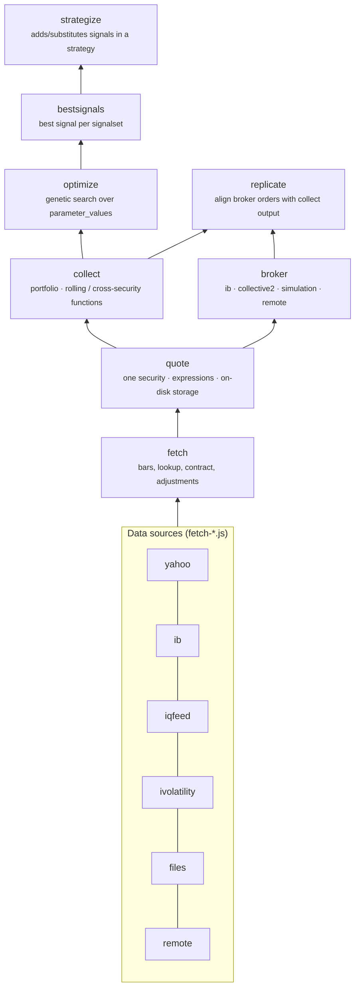
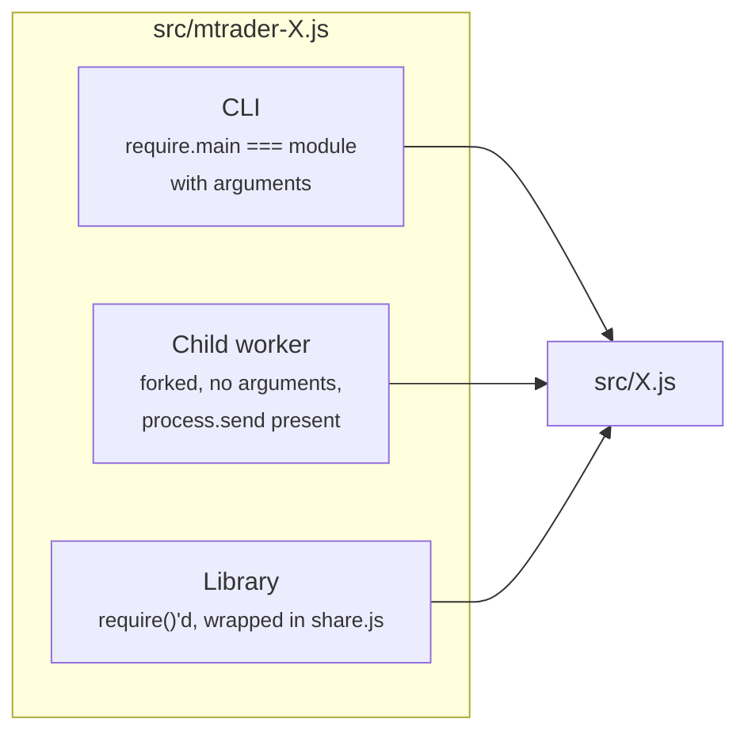
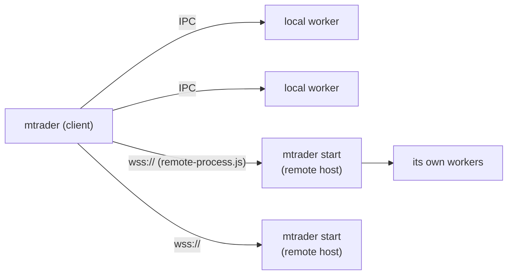

# Architecture

mtrader is a stack of layers. Each layer is a function that takes an options object
and returns a promise of rows, and each one is built on the layer below it. The same
layers back the library API, the CLI subcommands, the interactive shell and a
headless network service.

## The layer stack



| Layer | Logic | Responsibility |
|---|---|---|
| fetch | `src/fetch.js` | Routes a request (by `interval` and `market`) to the data source that serves it. Returns raw bars, symbol lookups, contract details, fundamentals or split/dividend adjustments. |
| quote | `src/quote.js`, `quote-model.js`, `periods.js` | Evaluates `columns`/`criteria` expressions over a single security's bars across multiple intervals. Computed columns are kept in `storage.js` so they aren't recalculated. |
| collect | `src/collect.js` | Runs `quote` for every security in a `portfolio`, merges the rows by time and evaluates portfolio-wide expressions (`PREV`, `PREC`, `COUNTPREC`, `MAXCORREL`, …). This is where backtests happen. |
| optimize | `src/optimize.js` | A genetic search over `parameter_values`. Each candidate is scored by `eval_score` on a `collect` result. |
| bestsignals | `src/bestsignals.js` | Runs `optimize` once per candidate signal in a signalset and ranks them. |
| strategize | `src/strategize.js` | Iteratively improves a strategy expression by adding, removing and substituting signals chosen by `bestsignals`. |
| broker | `src/broker.js` | One interface over live, remote and simulated accounts: balances, positions, orders, submit and cancel. |
| replicate | `src/replicate.js` | Compares the last order row of a `collect` result with the broker's working orders and positions, then submits or cancels orders to align them. |

The layers above `collect` don't know how backtests are computed. They just call the
layer below with different options. A strategy written as a `collect` request can
therefore be optimized, signal-tested, strategized and finally traded with `replicate`,
all using the same options.

## One interface for every layer

Every layer, data source and broker is created by a factory and returns the same
shape:

```js
const layer = Factory(settings, ...lowerLayers);
await layer(options);            // => array of row objects
await layer({info: 'help'});     // => [{name, usage, description, options, properties}]
await layer({info: 'version'});  // => [{version, ...}]
await layer({info: 'pending'});  // => queued/running work (where supported)
await layer.close();             // release sockets, child processes, file handles
```

The `info: 'help'` metadata does more than document the layer:

- **Validation and filtering.** Each layer passes on only the options its
  help says it accepts, e.g. `_.pick(options, _.keys(help.options))` in
  `quote.js` and `collect.js`. Unknown options are dropped rather than passed down.
- **Routing.** `fetch.js` asks each data source for its help and builds a
  `interval → market → source` table from the `interval` and `market` values each
  one advertises.
- **Field discovery.** `properties` lists the fields that expressions may reference
  (such as `day.close`), and layers read it to decide which fields an expression
  can use.
- **User documentation.** The interactive shell's `help <command>` text and the
  generated [reference](reference/README.md) are both rendered from it.

When you add an option, add it to the layer's `help()` too. Otherwise the layer
above will drop the option silently.

## Process model

Each command has a pair of modules. `src/X.js` holds the logic (the layer above),
and `src/mtrader-X.js` wraps it. Each wrapper serves three roles, chosen when the
module loads:



- **CLI**: `mtrader X ...` runs `mtrader-X.js` as an executable subcommand and
  prints the rows with `tabular.js`.
- **Child worker**: heavy layers (`quote`, `collect`, …) start child
  processes with `config.fork()`. A child answers requests over IPC through
  `promise-reply.js`, which provides promise-based request/response over
  `process.send`. Configuration changes in the parent are forwarded to its children.
- **Library**: `share.js` makes the factory reference-counted, so all callers in a
  process share one instance. The instance is torn down only when the last
  caller calls `close()` (or on SIGINT/SIGTERM).

Pass `--runInBand` (`config('runInBand', true)`) to keep everything in one process.
The tests do this, and it's the easiest way to debug.

`src/mtrader.js` puts all the wrappers together into the public API
(`new Mtrader()`) and the interactive shell (run `mtrader` with no arguments).

## Distributed work



- `worker-queue.js` is a load-balancing queue. It sends each task to the
  least-loaded worker in the lowest available *tier*, and spreads ties at random.
- `remote-workers.js` uses the same queue with remote mtrader services as the workers.
  When one fails, the task is retried on a different worker.
- `remote-process.js` gives a WebSocket connection, optionally mutual TLS (see
  `remote.*` in [configuration](configuration.md)), the same interface as a forked
  child. A remote service is therefore just another worker.
- `mtrader start` (`mtrader-start.js`) is the server side. It listens on
  `remote.listen` and serves requests with its own `Mtrader` instance.
- `collect.remote`, `fetch.remote` and `broker.remote` tell a client to send
  work to these services.

## Storage and caching

| Module | What it stores | Where |
|---|---|---|
| `storage.js` | Per-security collections of bars and computed columns, as gzipped CSV with metadata. The quote layer's long-lived store. | `<cache_dir>/<market>/…` |
| `fetch-files.js` | Record/replay cache in front of the other data sources. Tests replay from `test/data`. | `fetch.files.dirname` |
| `disk-cache.js` | Memoizes whole results on disk, keyed by a hash of the options (used by collect). | `<cache_dir>` |
| `memoize-cache.js` | In-memory LRU-style memoization of promises. | memory |
| `atomic-write.js`, `read-write-lock.js` | Atomic file replacement and coordination between processes for the stores above. | – |
| `broker-simulation.js` | Simulated account state. | `<lib_dir>` |

`cache_dir` is safe to delete; it fills again from the data sources. `lib_dir`
holds simulation and order state that you may want to keep.

## The expression language

`parser.js` is a generic parser for an Excel-like expression grammar. It doesn't
evaluate anything itself. The caller supplies `constant`, `variable` and
`expression` handlers, and the parser builds whatever those handlers return,
normally closures over a row context. Each layer adds its own function library:

| Library | Available in | Examples |
|---|---|---|
| `common-functions.js` | everywhere | `IF`, `ROUND`, `DATE`, `BS`, `BSIV` |
| `lookback-functions.js` | quote and above | `SMA`, `EMA`, `OFFSET`, `HIGHEST`, `RSI` |
| `indicator-functions.js` | quote and above (interval-prefixed) | `day.ATR`, `day.PSAR`, `day.OBV` |
| `rolling-functions.js` | collect and above | `PREV`, `PREC`, `COUNTPREC`, `SUMTOTAL`, `LOOKUP` |
| `quoting-functions.js` | collect and above | `MAXCORREL`, `SPLIT`, `DIVIDEND` |

See [expressions](expressions.md) and the generated
[function reference](reference/functions.md).

## Configuration flow

`config.js` is a process-wide singleton. It merges these sources, with later ones
taking precedence:

1. `etc/mtrader.json` bundled with the package
2. `<prefix>/etc/mtrader.json`
3. the session file named with `--load <name>` (looked up in `config_dir`)
4. command-line options
5. `--set a.b=value`, `--add-column`, `--add-variable` and values set at runtime
   with `config(name, value)`

Forked children receive the parent's effective configuration as arguments and are
sent later changes over IPC. See [configuration](configuration.md).

## Source map

| Area | Files |
|---|---|
| Entry points | `mtrader.js`, `mtrader-*.js` |
| Layers | `fetch.js`, `quote.js`, `collect.js`, `optimize.js`, `bestsignals.js`, `strategize.js`, `broker.js`, `replicate.js` |
| Data sources | `fetch-{yahoo,ib,iqfeed,ivolatility,files,remote}.js`, with their clients `*-client.js`, `ib-gateway.js` |
| Brokers | `broker-{ib,collective2,simulation,remote}.js` |
| Expressions | `parser.js`, `*-functions.js`, `quote-model.js`, `periods.js` |
| Processes | `share.js`, `promise-reply.js`, `worker-queue.js`, `remote-workers.js`, `remote-process.js`, `interrupt.js`, `auto-restart.js` |
| Storage | `storage.js`, `disk-cache.js`, `memoize-cache.js`, `atomic-write.js`, `read-write-lock.js`, `read-call-save.js` |
| Support | `config.js`, `mtrader-config.js`, `logger.js`, `tabular.js`, `merge.js`, `lookup.js`, `like.js`, … |
