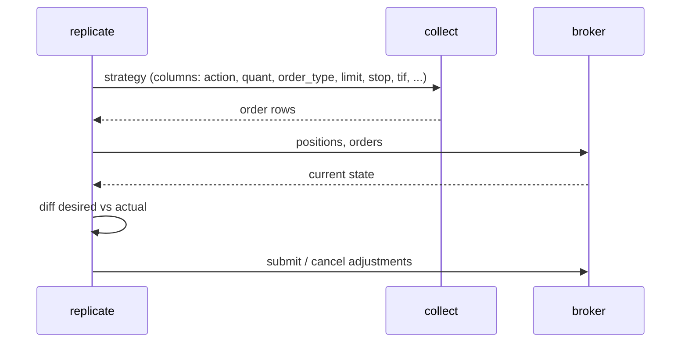

# Brokers and replication

`broker.js` gives every account the same interface: live (Interactive Brokers),
signal-service (Collective2), simulated, or on a remote mtrader service.
`replicate.js` uses that interface to keep an account in line with a strategy.

| Broker | Module | Needs (`broker.<name>`) |
|---|---|---|
| ib | `broker-ib.js` (+ `ib-client.js`, `ib-gateway.js`) | `enabled`, `account`, optionally `local_accounts`, `transmit`, and the IB Gateway connection under `ib` |
| collective2 | `broker-collective2.js` (+ `collective2-client.js`) | `enabled`, `systemid`, `apikey`, `transmit`, and the API endpoint URLs (defaults are in `etc/mtrader.json`) |
| simulation | `broker-simulation.js` | `enabled`, `simulation` (account name, stored in `lib_dir`), `commissions` schedule |
| remote | `broker-remote.js` | `enabled`, `location` of an `mtrader start` service |

## Actions

Every broker accepts an `action`. See the generated [broker reference](reference/broker.md)
for each action's options and the fields it returns.

| Action | Does |
|---|---|
| `balances` | Account balances, optionally historic |
| `positions` | Positions and the trades that changed them |
| `orders` | Working orders |
| `BUY`, `SELL`, `OCA`, `cancel` | Submit or cancel orders |
| `deposit`, `withdraw` | Move cash (simulation) |
| `reset` | Clear a simulated account |

```
mtrader broker balances
mtrader broker positions --set broker.simulation.simulation=paper
```

## Replicate

`replicate` runs a `collect` request (normally a saved strategy session) and
reads the last order row for each security. It compares that row with the broker's
current positions and working orders and works out the adjustments needed:



- The desired position is the sum of the `action`/`quant` columns.
- If the position has to change, an adjustment order is sent and working orders
  are cancelled. Otherwise the working orders in the last row (prefixed attributes)
  are submitted. A `stoploss` column creates a standing STP GTC order.
- Allocation options (`--allocation-pct`, `--allocation-max`, `--reserve-allocation`,
  …) scale positions to the account balance.
- `--dry-run` (`-n`) computes the orders without submitting them. Run it this way
  first against a live account.
